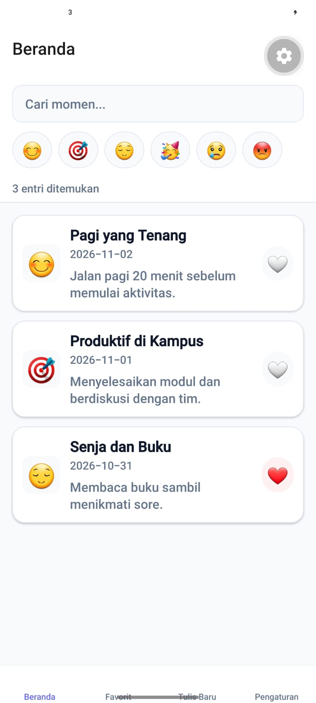
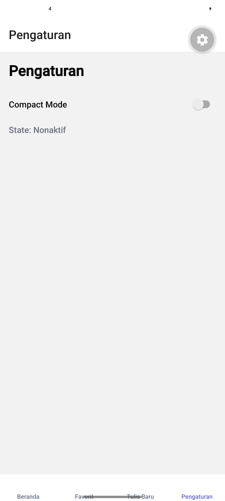
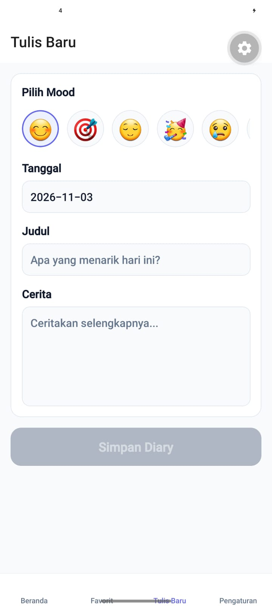

# 📖 Diary App Advanced - React Native

Aplikasi buku harian modern yang dibangun menggunakan **React Native** dan **Expo Router**. Project ini merupakan hasil implementasi dari Praktikum Mobile Programming Pertemuan 6 mengenai pengelolaan **State dan React Hooks**.

## 👨‍💻 Identitas Mahasiswa
- **Nama:** AHMAD YUSUF ABDHILLAH
- **NIM:** 2430511042
- **Mata Kuliah:** Mobile Programming
- **Program Studi:** Teknik Informatika
- **Universitas:** Universitas Muhammadiyah Sukabumi (UMMI)

---

## 📸 Screenshot Aplikasi

*(Tambahkan foto/screenshot aplikasi di bawah ini)*

| Home Screen & Filter | Detail & Like | Tambah Diary | Tab Favorit |
| :---: | :---: | :---: | :---: |
|  |  |  |  |

---

## 🚀 Fitur Utama
1. **Daftar Diary & Pencarian:** Menampilkan daftar diary dengan fitur pencarian yang dioptimalkan menggunakan teknik *Debounce*.
2. **Filter Mood:** Memfilter daftar diary berdasarkan kategori *mood* (emoticon) tertentu.
3. **Favorites (Suka):** Menyimpan dan menampilkan daftar diary yang disukai pengguna.
4. **Custom Hooks:** Pemisahan logika aplikasi (`useDiarySearch` dan `useLikedEntries`) agar komponen UI tetap bersih.

---

## 🛠️ Cara Menjalankan Project

1. Pastikan sudah menginstal **Node.js**.
2. Clone repository ini:
   ```bash
   git clone [https://github.com/mdzzZ7/diary-app-advanced.git](https://github.com/mdzzZ7/diary-app-advanced.git)
